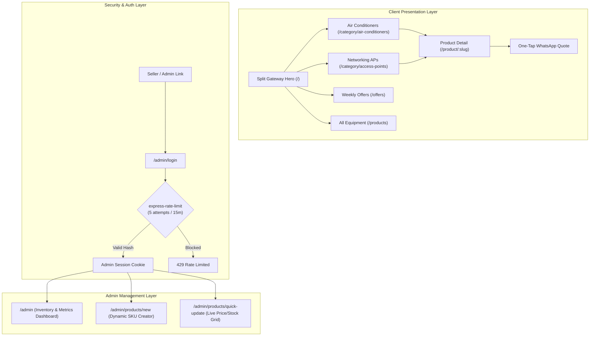

# FrostNet Technologies — Comprehensive Project Documentation & Status Report

**Repository**: `https://github.com/vinura2006/AC_web.git` (Branch: `main`)  
**Date**: November 8, 2026  
**System Type**: High-performance Node.js / Express EJS Catalog & Admin Management System  

---

## 1. Executive Summary

FrostNet Technologies is a dual-division hardware distribution platform specializing in:
1. **Climate Solutions**: Certified Inverter split, cassette, and portable air conditioning equipment.
2. **Enterprise Connectivity**: Wireless access points, PoE switches, and cloud-managed networking infrastructure.

The project operates under a direct wholesale catalog model: visitors browse live hardware inventory with verified distributor pricing, review technical datasheets, and initiate instant quote requests via WhatsApp without checkout friction. Authorized personnel manage stock and pricing through a password-protected, rate-limited administrative portal.

---

## 2. Completed Architecture & Milestones

### Milestone 1: Core Engine & Data Model
- **Business Logic Layer** (`src/lib/`):
  - `pricing.js`: Automated effective price, discount percentages, and active offer expiration rules.
  - `stock.js`: Exact vs. threshold stock messaging (`Out of stock`, `Only N left`, `In stock`).
  - `whatsapp.js`: URL-encoded, dynamic inquiry links embedding product names, models, and prices.
  - `format.js`: Currency formatting in Sri Lankan Rupees (`Rs 189,000`) and date localization (`Asia/Colombo`).
  - `markdown.js`: Sanitized markdown parser for product specifications.
- **Database Architecture** (`src/db/`):
  - PostgreSQL schema migration (`001_initial_schema.sql`) supporting dynamic JSONB spec definitions for schema-free hardware additions.
  - In-memory mock database engine (`src/db/mock-data.js`) allowing local offline testing without database lock-in.

### Milestone 2: Presentation & Conversion Redesign
- **Real Hardware Photography**:
  - Replaced abstract mock graphics with real photos for both Cooling and Enterprise APs extracted and optimized via `sharp`.
- **Homepage Discoverability & SEO** (`src/views/public/index.ejs`):
  - Visual Split Gateway hero with responsive hover focus.
  - Added dedicated **"Popular Air Conditioners"** showcase directly on the landing page for immediate customer engagement and SEO indexing.
- **Cooling Interactive Room Size Helper** (`src/views/public/products.ejs`):
  - Client-side BTU dimension tabs:
    - **All Capacities** (6 units total)
    - **Small Room** (<= 9,000 BTU)
    - **Master Bed** (12,000 – 18,000 BTU)
    - **Open Hall / Commercial** (>= 24,000 BTU)
  - Quick-toggle for **Inverter Eco** units only with live counter and empty-state fallback.
- **Enterprise Networking Datasheet & Compare Tool**:
  - Technical filter sidebar: Wi-Fi Generation (Wi-Fi 5 / 6 / 6E / 7), PoE standards (802.3af / at / bt), and Environment (Indoor vs Outdoor IP67).
  - Multi-item **Compare Tray**: Allows selection of up to 3 models simultaneously, opening a side-by-side datasheet comparison matrix.

### Milestone 3: Unified System-Adaptive Dark / Light Theme
- Refactored styles in `public/css/input.css`, `public/js/ui.js`, and `src/views/layouts/public.ejs`.
- Both Cooling and Networking categories now automatically adapt to the user's operating system preference (`prefers-color-scheme: dark` or `light`):
  - **Light Mode**: High-contrast, clean white surfaces with crisp blue/emerald accents and soft borders.
  - **Dark Mode**: Cyber graphite/charcoal surfaces (`#0B0F19`, `#161B22`) with neon green and cyan technical badges.
  - Pre-render execution prevents flash of unstyled theme on page load.

### Milestone 4: Security & Admin Access
- Direct seller access link integrated into the homepage trust bar and site footer with lock indicator.
- Authentication guarded by `express-rate-limit` (5 maximum attempts per 15 minutes) to prevent brute-force attacks.
- Admin dashboard supports:
  - Real-time inventory metrics (Total SKUs, low stock warnings, out-of-stock items, active promos).
  - Quick stock quantity and price edits without navigating to sub-pages.
  - Dynamic SKU creation form with category-specific attribute fields.

---

## 3. Test & Verification Audit Results

A comprehensive programmatic audit (`scripts/full-audit.js`) and the test framework were executed:

| Test Scope | Target View / Script | Bytes Rendered | Status |
|---|---|---|---|
| **Landing Page** | `public/index.ejs` | 34,700 B | **PASS** |
| **All Products** | `public/products.ejs` (Neutral) | 57,013 B | **PASS** |
| **Cooling Catalog** | `public/products.ejs` (Theme A) | 41,398 B | **PASS** |
| **Networking Catalog** | `public/products.ejs` (Theme B) | 44,301 B | **PASS** |
| **Product Detail (AC)** | `public/product-detail.ejs` | 28,289 B | **PASS** |
| **Product Detail (AP)** | `public/product-detail.ejs` | 26,998 B | **PASS** |
| **Weekly Offers** | `public/offers.ejs` | 31,071 B | **PASS** |
| **About Us** | `public/about.ejs` | 2,107 B | **PASS** |
| **Contact Showroom** | `public/contact.ejs` | 5,485 B | **PASS** |
| **Admin Login** | `admin/login.ejs` | 1,970 B | **PASS** |
| **Admin Dashboard** | `admin/dashboard.ejs` | 43,583 B | **PASS** |
| **Admin Product Form** | `admin/product-form.ejs` | 6,589 B | **PASS** |
| **Core Libraries** | `tests/lib.test.js` (10 tests) | — | **PASS (10/10)** |
| **Tailwind CSS Build** | `public/css/output.css` | 37,160 B | **PASS (0 errors)** |
| **Code Quality** | `eslint .` | — | **PASS (0 errors)** |

---

## 4. Next Steps Roadmap

1. **Production Cloud Database Provisioning**:
   - Set up an external PostgreSQL instance (e.g., Render PostgreSQL, Supabase, or Neon).
   - Configure `DATABASE_URL` in environment variables and run `npm run migrate` and `npm run seed:demo`.
2. **Cloud Web Service Deployment**:
   - Connect repository `https://github.com/vinura2006/AC_web.git` to Render as a **Web Service**.
   - Build Command: `npm install && npm run build:css`
   - Start Command: `node src/server.js`
3. **Custom Domain & SSL**:
   - Link custom domain with automated SSL certification.

